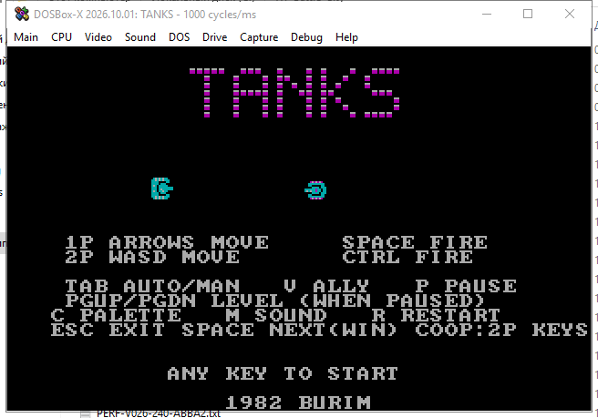
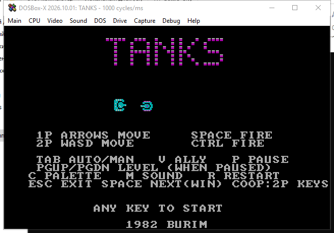
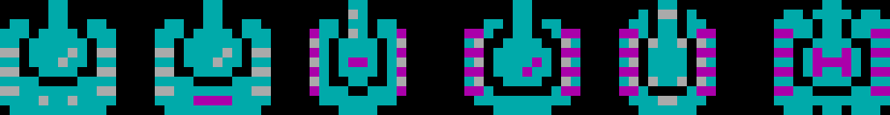
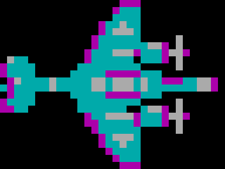
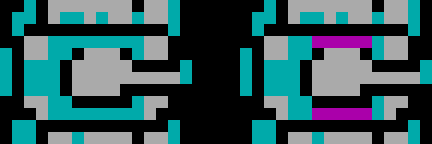
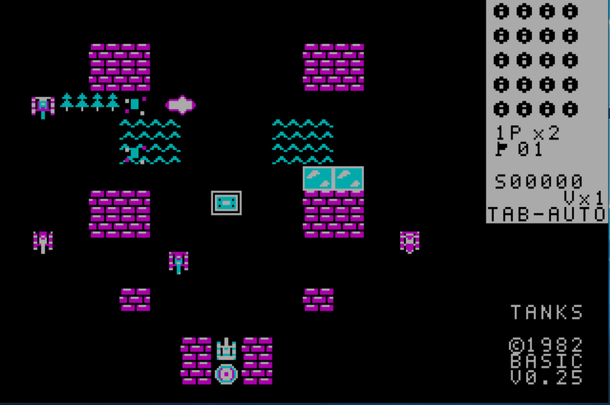
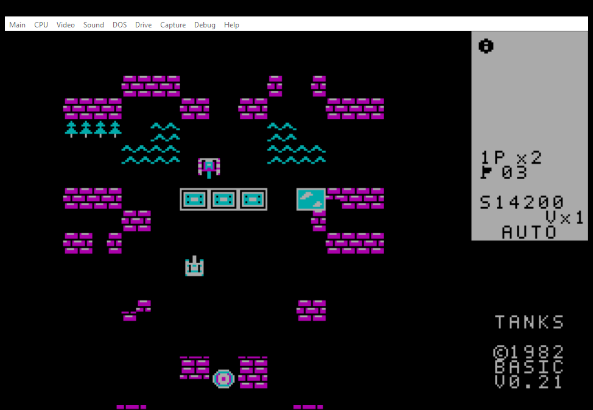

# Танчики — XT Battle City

**v0.34 · 15 ноября 2026 · DOS / IBM PC/XT 8086/8088 · CGA 320×200, 4 цвета**

Авторская подпись на панели — **TANKS ©1982 BURIM v0.34**. Самостоятельная аркада для **1–2 игроков** в духе классических танков: **35 собственных карт, по 20 противников на уровень**, штаб, разрушаемые кирпичи, сталь, вода, лес, лёд, разные классы танков, кооператив с отдельными жизнями и тактический AUTO. Код работает в 16-битном реальном режиме, без DOS-расширителей и обязательной звуковой карты.

### Скачать и запустить — v0.34

**[Скачать ZIP с игрой из GitHub Releases](https://github.com/BurimBasic/xt-battle-city/releases/download/v0.34/TANKS-v0.34-DOS-CGA.zip)** · **[TANKS.COM отдельно](https://github.com/BurimBasic/xt-battle-city/releases/download/v0.34/TANKS.COM)** · [Страница релиза v0.34](https://github.com/BurimBasic/xt-battle-city/releases/tag/v0.34) · [История](CHANGELOG.md) · [Техническая приёмка](releases/v0.34/RELEASE-NOTES.md)



*Реальный кадр заставки v0.33 из DOSBox-X на SLOW1. Звук проверялся отдельно; скриншот не демонстрирует аудио.*

**Обычный запуск на SLOW1 (обновлён до v0.34):** дважды нажми `C:\XT-Battle-City\RUN-CGA.cmd`. Это **уже установленная v0.34** из `run\TANKS.COM`; старые пути и ручная распаковка не нужны. Стартовый сценарий явно включает **CGA 320×200, Intel 8086 и AdLib/OPL2** в DOSBox-X. `GO.BAT` теперь запускает только актуальный `TANKS.COM`, а не случайно оставшийся старый `TANKS.EXE`. [Исходник RUN-CGA.cmd](tools/slow1/RUN-CGA.cmd) · [Исходник GO.BAT](tools/slow1/GO.BAT).

**Переносная версия для Windows x64 с DOSBox-X:** архив `C:\XT-Battle-City\TANKS-v0.34-PORTABLE-WIN64.zip` лежит **на SLOW1** (это не ZIP из GitHub Releases). Распаковывается в любую папку; внутри `START-TANKS.cmd` с AdLib, `START-SPEAKER.cmd` без OPL2 и `START-XT-240.cmd` с замедленной эмуляцией XT. На другом компьютере с установленным DOSBox-X также можно запустить скачанный `TANKS.COM`, выбрав 8086/CGA и смонтировав каталог игры.

**Проверено 15 ноября 2026 на SLOW1:** `run\TANKS.COM` — **57 266 байт**, SHA-256 `B5BC7F872BAF4DE62762D501C680B903DED8EFDBE9A96DAE76A7CB3173A9CB4F` (совпадает с кандидатом v0.34). Обновлённый профиль обычного запуска сохранил включённый AdLib/OPL2; DOS `/TEST` и распознавание AdLib/PC Speaker проверены также для v0.34. **Реальный двойной щелчок через `RUN-CGA.cmd` также проверен:** открылось интерактивное окно `DOSBox-X 2026.10.01: TANKS - 1000 cycles/ms`, процесс игры продолжил работать; тестовую копию закрыли отдельно. Перед заменой сценариев сделаны их резервные копии. Также пройдены **200 тестов**, 35 карт, аудит 8086 и AUTO 20/20; подробности в [заметках v0.34](releases/v0.34/RELEASE-NOTES.md).

Реальный PC/XT на 4,77 МГц пока отдельно не проверялся; нативные EGA/VGA/Hercules и «Поиск-1» не реализованы. После обновления файла игры уже открытое окно DOSBox-X необходимо перезапустить.

## Как играть: полное управление

| Клавиша | Действие |
|---|---|
| **Любая клавиша на заставке** | Немедленно начать игру, пропустив въезд танков и взрывы |
| **Tab** | AUTO ⇄ MAN **в одиночной игре**; при подключении 2P оба игрока управляют вручную |
| **↑ ↓ ← →** | **1P:** движение; в одиночной игре переводит AUTO в MAN |
| **Пробел** | **1P:** выстрел; в одиночном AUTO стрельба автоматическая |
| **W / A / S / D** | **2P:** движение (W вверх, A влево, S вниз, D вправо). **Первое нажатие любой из этих клавиш включает кооператив** и выключает AUTO 1P | 
| **Ctrl (левый или правый)** | **2P:** стрельба. Нажатие Ctrl тоже включает кооператив, не отнимая управление у 1P | 
| **V** | **Только одиночная игра:** вызвать автоматического напарника на 15 секунд; нельзя потратить последнюю жизнь. **В кооперативе автоматического напарника нет** |
| **P** | Пауза / продолжить |
| **Page Up / Page Down** | На паузе переключить уровень для проверки карты |
| **Пробел после победы** | Следующий уровень |
| **R** | Начать новую кампанию |
| **C** | Выбрать одну из четырёх CGA-палитр; настройка сохраняется только в RAM |
| **M** | Включить / выключить звук |
| **Esc** | Выход из игры |

Правая панель показывает оставшихся врагов, жизни, уровень, счёт, режим **AUTO/MAN/COOP**, собранный бонус и секунды. **В одиночной игре:** 1P и **V×N** (резерв автоматических напарников). **В кооперативе:** отдельные счётчики жизней **1P×3 2P×3** при старте, `V×N` в строке бонусов **отсутствует** (и не заменяется там на COOP); название режима отдельно. После гибели игрок возрождается рядом со штабом, если жизни ещё остались, а один живой игрок может продолжать за двоих. Союзник в одиночном режиме самостоятельный, стреляет и собирает бонусы. При вызове у него краткая мигающая защита (~2,6 секунды), затем остаётся отличительная цветная метка без постоянной неуязвимости.

## Все реализованные игровые возможности

- **Тактический AUTO:** отдельная логика защиты штаба и наступления противников, маршруты по карте, выход из заторов, преследование последнего врага за препятствием. **v0.29 проверяет срочные угрозы от всех семи вражеских снарядов между обычными решениями ИИ; при этом дальние выстрелы не срывают наступление.** **v0.24 считает повторяющиеся действия A–B–A–B у нашего танка и у каждого врага; при зацикливании выбирает проверенный проходимый боковой путь.** Игрок использует оба режима поведения с бонусами: **получает бонус только при касании видимой частью корпуса**, а AUTO может ехать за далёким бонусом, если базе ничего не угрожает. Не стреляет бесполезно через сталь, но стреляет по открытой цели даже при наличии бонуса.
- **Боевой AUTO:** во время заморозки врагов наш танк продолжает атаковать; получив лазер, агрессивно сближается с целью. При появлении **гранаты «уничтожить всех»**, **лазера** или **дополнительной жизни** AUTO отдаёт их подбору повышенный приоритет, **если маршрут достижим и базе не угрожает немедленная атака**. Враги действуют независимо, могут обстреливать друг друга и подбирать доступные им усиления с реальными эффектами.
- **Плавная физика:** танки и снаряды перемещаются попиксельно. Кирпичные стены разбиваются по четвертям; сталь обычно непробиваема без улучшений. Вода непроходима, лес скрывает объекты, лёд даёт скольжение.
- **Броня и повреждения:** усиленные враги выдерживают несколько попаданий. **Только у повреждённых бронированных противников** на гусеницах возникают небольшие **чёрные отметины** и скорость уменьшается вдвое. У неповреждённых танков и у наших игроков лишних цветных точек нет.
- **Честные столкновения:** у снарядов есть собственные физические координаты; противники попадают друг в друга, а опасный рикошет может погубить даже наш танк.
- **Зрительные эффекты:** оригинальные CGA-спрайты, анимация гусениц и взрывов, меняющий цвет лазер без оставшихся следов, три заметные анимации перехода между уровнями. В **v0.29** снаряд появляется **снаружи кончика ствола**, а не внутри корпуса; у среза дула вспышка видна два кадра, ствол откатывается на **2 пикселя** и возвращается по **1 пикселю** за такт. Эффект работает у 1P и 2P.
- **Звук v0.33:** автоматическое обнаружение AdLib/OPL2; в игре — короткие 2-операторные FM-эффекты выстрелов, взрывов и бонусов. На PC Speaker — только краткие сигналы длиной 1–2 тика (~55–110 мс), без непрерывного пищания и музыки. На заставке с AdLib — оригинальный двухголосный синтезаторный мотив 80-х (не копия **Axel F**). Звуковая карта необязательна; M отключает звук.
- **Самолёт-бомбардировщик (арт v0.29, правила вылета v0.31):** **утверждённый пользователем двухмоторный самолёт в духе аркады *1942*** (не копия ROM-спрайтов) — **32×24 настоящих пикселя (без растяжения 16×12)**, вдвое крупнее танка; четыре направления получены из **одного мастер-спрайта**, с широкими крыльями, хвостом, точными CGA-цветами и двумя анимированными винтами с отдельными ступицами и двухфазным вращением. Один пролёт на уровнях **1–5**, два на **6–14**, три на **15–35**. Первый вылет разрешён только после уничтожения 10 из 20 врагов, затем случайная задержка 48–175 тиков; направление и полоса случайны; самолёт летит 2 пикселя/тик. Бомбы взрываются строго позади оси, попеременно слева/справа шахматным порядком; наносят обычный урон танкам и кирпичам, **но не штабу**.
- **Наглядный подбор бонуса (v0.26):** предмет на карте не уничтожается выстрелами, лежит до 220 игровых тиков. При **реальном пересечении корпуса с бонусом** сам танк на несколько тактов меняет CGA-цвет, а HUD показывает полученный эффект. **Мигание пустой клетки и артефакты следа устранены**.
- **Кооператив v0.25:** каждому игроку три жизни, возрождение у базы при остатке жизней с краткой защитой, V×N убран из строки бонусов, пока играет 2P. 
- **Никаких обязательных файлов настроек:** состояние кампании, палитры и бонусов хранится в памяти.

- **Точно воспроизведённые пользовательские спрайты v0.30:** шесть оригинальных матриц **12×12 пикселей**, взятых непосредственно из предоставленной пользователем картинки 115×20: **наш танк → напарник → light → medium → assault → heavy**. Авторские синие пиксели отображаются как CGA cyan, красные как magenta, серые как светло-серые; белый фон — прозрачность. Вращение 90° выполняется на целой квадратной матрице без растяжения. Технические слоты движка остаются 16×12 (2 прозрачных пикселя по бокам), но **сам танк строго 12×12**. Напарник использует ровно четыре отличительных розовых пикселя, без дополнительного спрайтового атласа 1920 байт.
- **Вражеский выстрел из дула (v0.30):** обычные снаряды, дополнительные снаряды усиленного оружия и хаотичный залп, вражеский лазер и рикошет **стартуют с фактического среза ствола** в соответствии с направлением, а не из середины корпуса. Баллистика v0.29 для 1P и 2P сохранена.
- **Анимация винтов (v0.30):** координаты двух винтов точно закреплены за лопастями выбранного пользователем мастер-спрайта самолёта 32×24, во всех четырёх направлениях полёта. Короткая двухфазная анимация не создаёт отдельный атлас и не увеличивает нагрузку на поворот изображения.

## Новое в v0.34 — «Коробейники», AdLib с аппаратным шумом

- **Музыка заставки больше не придумана заново:** узнаваемая народная **«Коробейники»** (XIX век, общественное достояние, известна по Tetris). Использована историческая мелодия и ритм первых четырёх тактов из [нотной записи ABC](https://portenotes.lacultureataporte.fr/composition/repertoire/korobeiniki), **не звуковая запись или игровая аранжировка Nintendo**.
- **AdLib / YM3812, три слоя:** ведущий FM-голос, отдельная басовая линия и **аппаратные ударные с шумогенератором** (регистр `BDh`: бочка, малый барабан, хай-хэт). Ритм явно отбивает доли, без PCM/программного смешивания звука.
- **Боевые эффекты переделаны:** выстрел — короткая атака FM с шумовой составляющей, взрыв — низкий FM-удар с понижением высоты плюс бочка и малый барабан, бонус — отдельный короткий FM-сигнал. На PC Speaker только 1–2-тактовые короткие сигналы без музыки. `M` выключает звук.
- **Производительность и совместимость:** звуком управляют небольшие записи в регистры OPL2, без дополнительного таймера/IRQ. Все **200 тестов, 35 карт и аудит 8086 PASS**; на SLOW1 испытаны оба режима AdLib и PC Speaker, реальная WAV-запись FM-заставки и AUTO 20/20. В парном тесте 384 кадров v0.34 на **7,44% быстрее контрольной v0.19**.
- **Заставка и графика:** медленное встречное движение танков, кирпичный TANKS и спрайты v0.33 сохраняются. **Любая клавиша** немедленно прерывает музыку и начинает игру.

[Полная приёмка v0.34 и ограничения](releases/v0.34/RELEASE-NOTES.md)

## Новое в v0.33 — звук в духе японских аркад 80-х

- **AdLib/OPL2 (YM3812):** вместо резких длинных одноголосных тонов — собственные короткие двухоператорные FM-эффекты с быстрыми огибающими, разным регистром выстрела и взрыва, коротким понижением высоты взрыва. В игре используется отдельный FM-канал, музыка не мешает стрельбе.
- **Мелодия заставки:** оригинальный ритмичный синтезаторный мотив с FM-мелодией и басом на двух отдельных OPL2-каналах, с ритмическими паузами. Стиль напоминает электронные темы 80-х, в том числе звучание знаменитой **Axel F**, но **не воспроизводит чужую защищённую композицию**. После заставки музыка полностью выключается; любая клавиша немедленно обрывает её и начинает игру.
- **PC Speaker без AdLib:** только тихие по длительности короткие звуки выстрела (~55 мс) и взрыва (~110 мс) со снижением частоты, без непрерывного тона, зацикленной мелодии, программного PWM и задержек процессора. Физическую громкость обычного PC Speaker аппаратно регулировать нельзя.
- **Движение в заставке замедлено вдвое:** каждый танк движется на **1 физический пиксель за 2 BIOS-тика**, а не за 1 тик; остальные игровые скорости и утверждённые спрайты не меняются.
- **Автоматический выбор** между AdLib/OPL2 и PC Speaker подтверждён через специальный режим `TANKS.COM /AUDIO` в DOSBox-X с включённым и выключенным OPL2. Музыка не требует отдельных файлов, драйвера или конфигурации.

[Подробное описание и проверки v0.33](releases/v0.34/RELEASE-NOTES.md)

## Новое в v0.32

- **Настоящая стартовая заставка в DOS/CGA.** Кирпичная надпись **TANKS** нарисована из отдельных 3×3 CGA-пиксельных кирпичей с чёрным швом. Наш голубой и вражеский розовый танки медленно едут навстречу друг другу, обмениваются снарядами и взрываются; затем запускается игра. Любая клавиша **сразу прерывает заставку и запускает игру**, без дополнительного вступительного перехода. Вся анимация выполняется **только при запуске**, с тактированием BIOS ~18,2 Гц.
- **Управление целиком на заставке:** 1P стрелки и пробел; 2P WASD и Ctrl; Tab AUTO/MAN, V союзник, P пауза, PageUp/PageDown уровень на паузе, C палитра, M звук, R рестарт, Esc выход. Внизу — **1982 BURIM**.
- **Точно ограниченная анимация гусениц для всех танков.** Из предыдущего варианта устранены светлые точки, выходившие за границы корпуса. У пяти базовых рисунков (**игрок/напарник, light, medium, assault, heavy**) обе фазы и все четыре поворота проверены на **160 попаданий только в непрозрачные авторские пиксели** — без новых цветных точек за силуэтом. Анимация зависит от перемещения, не крутится на стоянке; повреждения тяжёлого танка остаются чёрными.
- **Без внешних файлов заставки:** кирпичный шрифт, текст и анимация встроены в один DOS `TANKS.COM`. Временные массивы карты и перерисовки инициализируются в оперативной памяти при старте, уменьшая файл без роста пикового использования памяти.

[Подробные заметки релиза v0.32](releases/v0.32/RELEASE-NOTES.md)

## Новое в v0.31

- **Движущиеся гусеницы** всех шести утверждённых танков: игрок, напарник/2P, light, medium, assault, heavy. Светлые звенья сдвигаются при реальном движении, а не при стоянии.
- **Дополнительная жизнь каждые 15 000 заработанных очков**, включая корректную обработку переполнения 16-битного счёта. В COOP по жизни **обоим игрокам**; очки и жизни **мигают вместе трижды**.
- **Пунктирная защита** вокруг танка через пиксель; привычные спрайты сохранены.
- **Самолёт после 10 уничтоженных врагов**, затем случайная задержка, направление и полоса вылета.
- **Точные пользовательские 100/200/300/400** всплывают в точке гибели противника три раза, поднимаясь на 1 пиксель при каждом появлении.
- **Иконки 14 бонусов** отодвинуты на 1 пиксель от края правой панели.


[Подробные заметки релиза и проверки v0.31](releases/v0.31/RELEASE-NOTES.md)

## Все 14 бонусов

Бонус выпадает **на месте уничтоженного врага**, если клетка доступна, и лежит до подбора или истечения времени ожидания: **снаряд не может его уничтожить**. **Подбирается лишь при фактическом касании корпуса танка бонуса** — всеми игроками, союзником и врагами. **Подбор подтверждается короткой сменой цвета получившего бонус танка**; старого мигающего следа на пустой клетке больше нет. **В кооперативе бонусов вдвое меньше**, чем в одиночной игре. Враги перехватывают боевые бонусы и реально стреляют полученным оружием, в том числе лазером; **сердце и резерв V врагам недоступны**. В кооперативе сердце добавляет жизнь тому из двух игроков, кто его взял. Одновременно на карте находится один выпавший бонус.

| Бонус | Действие |
|---|---|
| ⭐ **Звезда** | Улучшение танка: повышает мощность/скорость выстрелов и на максимальном уровне позволяет пробивать сталь |
| 🪖 **Шлем** | Временная защита от попаданий |
| 💣 **Граната** | Уничтожает активных противников |
| 🛠️ **Лопата** | Временно укрепляет стены штаба сталью |
| 🕒 **Часы** | Останавливает вражеские танки, но не наш AUTO; в руках противника может замедлить игрока |
| ❤️ **Сердце** | Дополнительная жизнь (максимум девять) |
| ⚡ **Лазер** | Мгновенный эффективный цветопеременный луч на время бонуса |
| **V / Союзник** | В одиночной игре добавляет вызов AUTO-напарника; в кооперативе вызов блокируется (2P уже использует этот танк) |
| **Тройной огонь** | Одновременно выпускает до трёх снарядов |
| **Самонаведение** | Снаряды корректируют полёт к цели |
| **Хаос** | Вражеские танки начинают стрелять друг по другу |
| 🏓 **Пинг-понг** | Один быстрый диагональный шарик на **10 секунд**: отскакивает от стен и границ, поражает любые танки, **включая наш**. Пока шарик существует, второй не запускается |
| **Четыре стороны** | Настоящий залп из **четырёх отдельных снарядов** вверх, вправо, вниз и влево |
| **Суперснаряд** | Цветопеременный мощный снаряд проходит сквозь танки и препятствия, уничтожая всё на пути, пока не покинет поле |

Выпавший бонус остаётся на карте до 220 игровых тиков (примерно 12 секунд). Время активных оружейных бонусов обычно 10 секунд по игровым тикам. Отдельные бонусы (например, шлем, часы и укрепление базы) имеют собственную длительность. Способность врага сохраняется только отведённое время, а не навсегда меняет его класс.

## Скриншоты и поддержка видеоадаптеров

[Кадр заставки v0.33 из DOSBox-X](docs/screenshots/CGA-DOSBox-X-v0.33-title-real.png) — снят на SLOW1; FM/AdLib проверен отдельно через `/AUDIO`.



*Настоящий кадр **интерактивной заставки v0.32**, снят непосредственно с окна DOSBox-X **2026.10.01** на SLOW1: эмуляция 8086, CGA mode 4, 1000 cycles/ms. Не художественный макет. Захват заставки, не игрового процесса; игровой кадр v0.32 пока отдельно не подтверждён.*



*Проверяемая графика **из точных авторских матриц** v0.30 (12×12), масштаб ×12 nearest neighbour; **не скриншот игрового процесса**. [Открыть реальные пиксели 1:1](docs/art/v030-user-six-12x12-native.png).*



*Оригинальное увеличенное арт-превью спрайта v0.29 (32×24 пикселя, масштабировано для просмотра). **Не скриншот игры**; размер в бою относительно танка — 2×.*



*Проверяемое арт-превью из **точных матриц 16×12**: слева P1, справа V/2P. Не игровой скриншот.*



*Подлинный кадр предыдущей v0.25, предоставленный при описании ошибки, не представлен как снимок v0.29.*



*Архивный игровой кадр v0.21 (SLOW1, DOSBox-X 2026.10.01). Заставка v0.33 снята отдельно; актуальный игровой кадр v0.33 ещё не публиковался.*

| Адаптер | Поддержка | Скриншот |
|---|---|---|
| **CGA 320×200, 4 цвета** | Основной режим, сборка и тесты на SLOW1 | [Подлинная заставка v0.33](docs/screenshots/CGA-DOSBox-X-v0.33-title-real.png), [заставка v0.32](docs/screenshots/CGA-DOSBox-X-v0.32-title-real.png), [Скриншот CGA v0.25 от игрока](docs/screenshots/CGA-user-v0.25-real.png), [архивный CGA v0.21](docs/screenshots/CGA-DOSBox-X-v0.21-live.png); актуальный кадр *игрового процесса* v0.33 — ожидает отдельного захвата |
| **EGA** | Протестирован только **CGA mode 4 compatibility**; настоящего EGA 16-цветного драйвера нет | Ожидается отдельный честно подписанный захват |
| **VGA** | Протестирован только **CGA mode 4 compatibility**; настоящего VGA 256-цветного драйвера нет | Ожидается отдельный честно подписанный захват |
| **Hercules** | Нативного драйвера пока нет; предыдущий тест режима не прошёл | Скриншот ещё невозможен |
| **«Поиск-1»** | Отдельные драйвер/бездисковая загрузка не готовы | Нативного снимка нет |

**Никакие скриншоты с CGA-совместимостью не выдаются за нативную EGA/VGA/Hercules-графику.** Галерея пополняется только настоящими захватами указанного режима.

Также доступны [эскизы оригинальной CGA-графики](docs/preview-art-v11.png) — это *арт-превью*, не снимок экрана эмулятора.

## Сборка и проверки

Нужны GNU `as`, `ld`, `make` и Python 3:

```sh
make assets
make clean all test
make build/TANKS-TRACE.COM build/TANKS-PERF.COM
```

`build/TANKS.COM` — обычная игра; `build/TANKS-TRACE.COM` — диагностическая симуляция, `build/TANKS-PERF.COM` — 384-кадровый тест. Для проверки DOS используй `TANKS.COM /TEST`. Перед **каждым** релизом обязательны GitHub CI, аудит команд 8086 и ограничения **56 КиБ**, DOSBox-X /TEST, тест прохождения первого этапа, сравнение производительности с принятой v0.19, резервная копия и повторное тестирование установленного файла.

**Документация:** [правила релизов](AGENTS.md), [описание архитектуры](docs/ARCHITECTURE.md), [аппаратура и память](docs/MEMORY.md), [35 уровней](docs/CAMPAIGN.md), [видеоадаптеры](docs/VIDEO.md), [цель «Поиск-1»](docs/POISK1.md), [тесты](docs/TESTING.md), [полная история](CHANGELOG.md). Код под лицензией [MIT](LICENSE). Авторские карты, графика и звук не копируются из коммерческих ROM.
