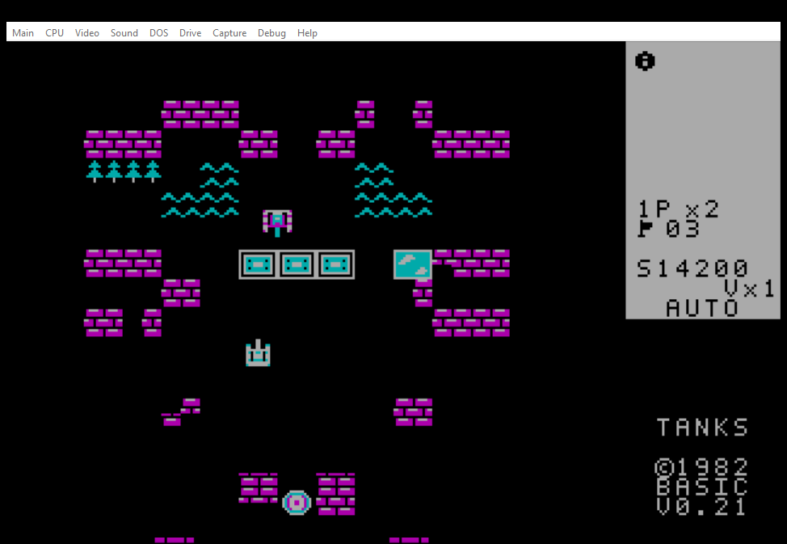

# Танчики — XT Battle City

**v0.24 · 12 ноября 2026 · DOS / IBM PC/XT 8086/8088 · CGA 320×200, 4 цвета**

Самостоятельная аркада для **1–2 игроков** в духе классических танков: **35 собственных карт, по 20 противников на уровень**, штаб, разрушаемые кирпичи, сталь, вода, лес, лёд, разные классы танков, кооператив с отдельными жизнями и тактический AUTO. Код работает в 16-битном реальном режиме, без DOS-расширителей и обязательной звуковой карты.

### Скачать и запустить

**[Скачать ZIP v0.24 через GitHub Releases](https://github.com/BurimBasic/xt-battle-city/releases/download/v0.24/TANKS-v0.24-DOS-CGA.zip)** · **[Скачать TANKS.COM](https://github.com/BurimBasic/xt-battle-city/releases/download/v0.24/TANKS.COM)** · [Все релизы](https://github.com/BurimBasic/xt-battle-city/releases) · [История](CHANGELOG.md) · [Релиз v0.24](releases/v0.24/RELEASE-NOTES.md)

**Сборка v0.24:** 52 914 байт (меньше 56 КиБ). Проверки: 145 Python-тестов, 35 карт и аудит 8086 — PASS; встроенный DOS `/TEST` и контрольный бой 20/20 — PASS. Точный SHA-256, дополнительные скоростные измерения и журнал установки указаны в [заметках к релизу](releases/v0.24/RELEASE-NOTES.md). Не путай эту DOS/CGA-сборку с ещё не существующими нативными EGA/VGA/Hercules/«Поиск-1» версиями.

На SLOW1 запуск: `C:\XT-Battle-City\RUN-CGA.cmd`. На другой системе с DOSBox-X: выбери эмуляцию **8086**, **CGA**, смонтируй каталог с `TANKS.COM` как диск `C:` и введи `TANKS.COM`. После переустановки исполняемого файла уже открытое окно игры нужно перезапустить.

Версия предназначена для CGA-совместимого DOS. Реальная скорость на физическом XT 4,77 МГц и нативная загрузка «Поиск-1» пока не подтверждены; тест DOSBox-X не заменяет испытание на железе.

## Как играть: полное управление

| Клавиша | Действие |
|---|---|
| **Tab** | AUTO ⇄ MAN **в одиночной игре**; при подключении 2P оба игрока управляют вручную |
| **↑ ↓ ← →** | **1P:** движение; в одиночной игре переводит AUTO в MAN |
| **Пробел** | **1P:** выстрел; в одиночном AUTO стрельба автоматическая |
| **W / A / S / D** | **2P:** движение (W вверх, A влево, S вниз, D вправо). **Первое нажатие любой из этих клавиш включает кооператив** и выключает AUTO 1P | 
| **Ctrl (левый или правый)** | **2P:** стрельба. Нажатие Ctrl тоже включает кооператив, не отнимая управление у 1P | 
| **V** | **Только одиночная игра:** вызвать автоматического напарника на 15 секунд; нельзя потратить последнюю жизнь. **В кооперативе автоматического напарника нет** |
| **P** | Пауза / продолжить |
| **Page Up / Page Down** | На паузе переключить уровень для проверки карты |
| **Пробел после победы** | Следующий уровень |
| **R** | Начать новую кампанию |
| **C** | Выбрать одну из четырёх CGA-палитр; настройка сохраняется только в RAM |
| **M** | Включить / выключить звук |
| **Esc** | Выход из игры |

Правая панель показывает оставшихся врагов, жизни, уровень, счёт, режим **AUTO/MAN/COOP**, собранный бонус и секунды. **В одиночной игре:** 1P и **V×N** (резерв автоматических напарников). **В кооперативе:** отдельные счётчики **1P×1 2P×1**, оба игрока стреляют и ездят сами; смерть одного не забирает жизни другого. Союзник в одиночном режиме самостоятельный, стреляет и собирает бонусы. При вызове у него краткая мигающая защита (~2,6 секунды), затем остаётся отличительная цветная метка без постоянной неуязвимости.

## Все реализованные игровые возможности

- **Тактический AUTO:** отдельная логика защиты штаба и наступления противников, маршруты по карте, выход из заторов, преследование последнего врага за препятствием. **v0.24 считает повторяющиеся действия A–B–A–B у нашего танка и у каждого врага; при зацикливании выбирает проверенный проходимый боковой путь.** Игрок использует оба режима подбора бонусов: забирает их рядом с собой (в пределах **1,5 клетки**) и может выехать за далёким бонусом, когда базе ничего не угрожает. Не стреляет бесполезно через сталь, но стреляет по открытой цели даже при наличии бонуса.
- **Боевой AUTO:** во время заморозки врагов наш танк продолжает атаковать; получив лазер, агрессивно сближается с целью. Враги действуют независимо, могут обстреливать друг друга и подбирать доступные им усиления с реальными эффектами.
- **Плавная физика:** танки и снаряды перемещаются попиксельно. Кирпичные стены разбиваются по четвертям; сталь обычно непробиваема без улучшений. Вода непроходима, лес скрывает объекты, лёд даёт скольжение.
- **Броня и повреждения:** усиленные враги выдерживают несколько попаданий. **Только у повреждённых бронированных противников** на гусеницах возникают небольшие **чёрные отметины** и скорость уменьшается вдвое. У неповреждённых танков и у наших игроков лишних цветных точек нет.
- **Честные столкновения:** у снарядов есть собственные физические координаты; противники попадают друг в друга, а опасный рикошет может погубить даже наш танк.
- **Зрительные эффекты:** оригинальные CGA-спрайты, анимация гусениц и взрывов, меняющий цвет лазер без оставшихся следов, три заметные анимации перехода между уровнями.
- **Звук:** PC Speaker, автоматическая поддержка совместимой AdLib/OPL2; звуковая карта необязательна.
- **Никаких обязательных файлов настроек:** состояние кампании, палитры и бонусов хранится в памяти.

## Все 14 бонусов

Бонус выпадает **на месте уничтоженного врага**, если клетка доступна. Брать его можно, находясь в пределах 1,5 клетки, даже не двигаясь. **В кооперативе бонусов вдвое меньше**, чем в одиночной игре. Враги перехватывают боевые бонусы и реально стреляют полученным оружием, в том числе лазером; **сердце и резерв V врагам недоступны**. В кооперативе сердце добавляет жизнь тому из двух игроков, кто его взял. Одновременно на карте находится один выпавший бонус.

| Бонус | Действие |
|---|---|
| ⭐ **Звезда** | Улучшение танка: повышает мощность/скорость выстрелов и на максимальном уровне позволяет пробивать сталь |
| 🪖 **Шлем** | Временная защита от попаданий |
| 💣 **Граната** | Уничтожает активных противников |
| 🛠️ **Лопата** | Временно укрепляет стены штаба сталью |
| 🕒 **Часы** | Останавливает вражеские танки, но не наш AUTO; в руках противника может замедлить игрока |
| ❤️ **Сердце** | Дополнительная жизнь (максимум девять) |
| ⚡ **Лазер** | Мгновенный эффективный цветопеременный луч на время бонуса |
| **V / Союзник** | В одиночной игре добавляет вызов AUTO-напарника; в кооперативе вызов блокируется (2P уже использует этот танк) |
| **Тройной огонь** | Одновременно выпускает до трёх снарядов |
| **Самонаведение** | Снаряды корректируют полёт к цели |
| **Хаос** | Вражеские танки начинают стрелять друг по другу |
| 🏓 **Пинг-понг** | Один быстрый диагональный шарик на **10 секунд**: отскакивает от стен и границ, поражает любые танки, **включая наш**. Пока шарик существует, второй не запускается |
| **Четыре стороны** | Настоящий залп из **четырёх отдельных снарядов** вверх, вправо, вниз и влево |
| **Суперснаряд** | Цветопеременный мощный снаряд проходит сквозь танки и препятствия, уничтожая всё на пути, пока не покинет поле |

Время активных оружейных бонусов обычно 10 секунд по игровым тикам. Отдельные бонусы (например, шлем, часы и укрепление базы) имеют собственную длительность. Способность врага сохраняется только отведённое время, а не навсегда меняет его класс.

## Скриншоты и поддержка видеоадаптеров



*Реальный архивный игровой экран CGA (SLOW1, DOSBox-X 2026.10.01, v0.21). Он подписан своей реальной версией и не выдаётся за снимок v0.24.*

| Адаптер | Поддержка | Скриншот |
|---|---|---|
| **CGA 320×200, 4 цвета** | Основной режим, сборка и тесты на SLOW1 | [Архивный CGA v0.21](docs/screenshots/CGA-DOSBox-X-v0.21-live.png); [актуальный CGA v0.24](docs/screenshots/CGA-DOSBox-X-v0.24-coop.png) |
| **EGA** | Протестирован только **CGA mode 4 compatibility**; настоящего EGA 16-цветного драйвера нет | Ожидается отдельный честно подписанный захват |
| **VGA** | Протестирован только **CGA mode 4 compatibility**; настоящего VGA 256-цветного драйвера нет | Ожидается отдельный честно подписанный захват |
| **Hercules** | Нативного драйвера пока нет; предыдущий тест режима не прошёл | Скриншот ещё невозможен |
| **«Поиск-1»** | Отдельные драйвер/бездисковая загрузка не готовы | Нативного снимка нет |

**Никакие скриншоты с CGA-совместимостью не выдаются за нативную EGA/VGA/Hercules-графику.** Галерея пополняется только настоящими захватами указанного режима.

Также доступны [эскизы оригинальной CGA-графики](docs/preview-art-v11.png) — это *арт-превью*, не снимок экрана эмулятора.

## Сборка и проверки

Нужны GNU `as`, `ld`, `make` и Python 3:

```sh
make assets
make clean all test
make build/TANKS-TRACE.COM build/TANKS-PERF.COM
```

`build/TANKS.COM` — обычная игра; `build/TANKS-TRACE.COM` — диагностическая симуляция, `build/TANKS-PERF.COM` — 384-кадровый тест. Для проверки DOS используй `TANKS.COM /TEST`. Перед **каждым** релизом обязательны GitHub CI, аудит команд 8086 и ограничения **56 КиБ**, DOSBox-X /TEST, тест прохождения первого этапа, сравнение производительности с принятой v0.19, резервная копия и повторное тестирование установленного файла.

**Документация:** [правила релизов](AGENTS.md), [описание архитектуры](docs/ARCHITECTURE.md), [аппаратура и память](docs/MEMORY.md), [35 уровней](docs/CAMPAIGN.md), [видеоадаптеры](docs/VIDEO.md), [цель «Поиск-1»](docs/POISK1.md), [тесты](docs/TESTING.md), [полная история](CHANGELOG.md). Код под лицензией [MIT](LICENSE). Авторские карты, графика и звук не копируются из коммерческих ROM.
