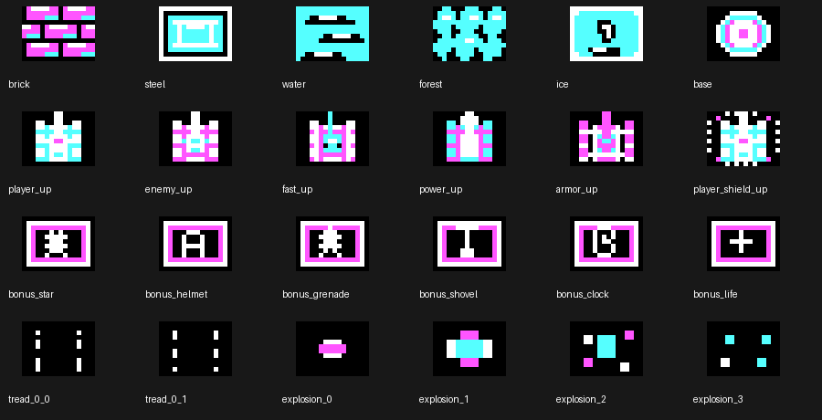
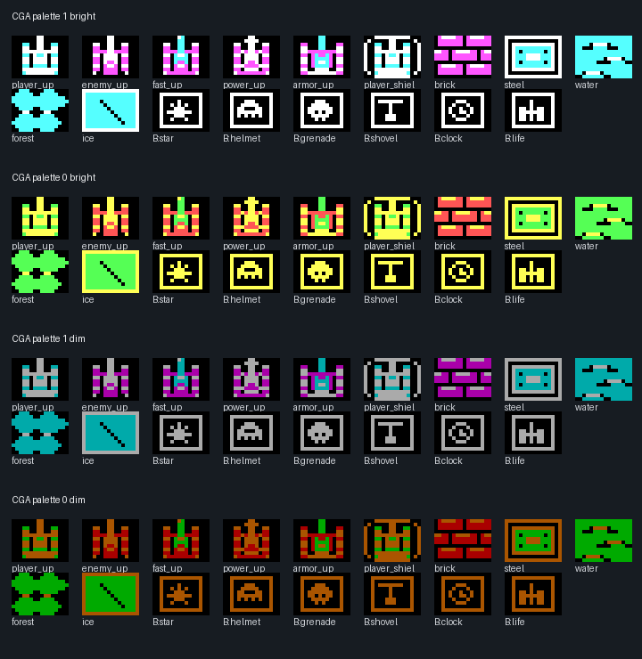

# CGA pixel-art design and performance rules — v0.9

The project uses original assets, never extracted console sprites. Its rendering baseline is original IBM PC/XT (8088 at 4.77 MHz), real CGA 320×200, four simultaneous colors and a 16×12 pixel world tile.

## Legibility at native resolution

- Design a recognizable **silhouette first**; details cannot compensate for a weak outline.
- Player tank is a compact cyan body with a white turret and distinct barrel. Enemy classes have different *geometry*, not only palette swaps: basic, fast/light, power/heavy-barrel, armored/wide shoulders.
- Draw using a few large color clusters, rather than scattered 1px noise. Use the fourth color for focal points and edges.
- Two tread frames are based on movement position and never animate while the tank is stationary.
- A shield adds an external contour; the unshielded tank pixels remain unchanged.
- Every bonus has a fixed frame and a symbol aligned by its occupied-pixel bounding box to the **tile center**, not an arbitrary hand offset.
- Brick courses have true black mortar, broad magenta faces and sparse white/cyan highlights. Steel uses a simple beveled plate; water has repeated large wave shapes; forest uses leaf clusters; ice uses large highlights and sparse cracks.
- Four CGA palette combinations must remain playable (`C` key). No hidden VGA/EGA colors in CGA artwork.

## Anti-flicker composition

The v0.8 implementation restored old tiles in **visible** B800 CGA VRAM, leaving a transient gap before drawing moving objects. On 4.77 MHz this gap is noticeable as tank flicker.

The v0.9 algorithm renders static background and transparent sprites into a **16 KiB conventional RAM buffer** (`INT 21h` allocate 1024 paragraphs after shrinking the DOS COM block). After a complete frame, only the changed 16×12 tiles are copied as whole pieces into visible CGA VRAM. The fallback is direct B800 writes if allocation fails, so low-memory DOS can still run with the old flicker trade-off.

Core properties:
- CGA alternating even/odd scanlines in two 8KiB banks (`B800:0000` and `B800:2000`), 2 bits/pixel.
- 16×16 tiles represent 256×192 world pixels; rightmost 64px reserve HUD.
- Sprite pixels are precomputed into four X phases with packed mask/color bytes. CPU does only bytewise mask-compositing at runtime.
- Static restore and all sprites render first, then changed tiles are copied to VRAM. No full-screen copy each frame.
- Avoid interrupts-off drawing and do not write video RAM from the keyboard IRQ.

## Verification and limitations

Run `make test`, then `TANKS.COM /TEST` via DOSBox-X on SLOW1. The DOS smoke test additionally compares buffer contents against video memory at two world locations after a rendered frame. Manual testing must still confirm no flicker in ordinary play and record frame cadence at emulated **8088 4.77 MHz**. DOSBox-X success does *not* prove hardware-compatible speed; final cycle measurements need 86Box or real XT.

CGA source reference: [IBM CGA Technical Reference](https://www.minuszerodegrees.net/oa/OA%20-%20IBM%20Color%20Graphics%20Monitor%20Adapter%20%28CGA%29.pdf).
Pixel-art cluster principles: [Pixel Art Simplification (Rivals Workshop)](https://www.rivalslib.com/workshop_guide/art/simplification.html).

## v0.10 visual acceptance

At native 320×200 size, player, basic, fast, power and armored tanks must remain recognizably tanks through **tracks/chassis/turret/muzzle**, not a bag of sparkles. They use distinct chassis/gun proportions; four palette combinations should preserve the hierarchy even when hues change. The 12×12 artwork core is pre-rotated into four directions; there is no runtime resampling and no blurred sprites.

Textures have intentionally different **forms**: brick is staggered courses, steel is a riveted machine plate, water is transverse wave crests, forest is grouped foliage, ice is a single diagonal crack. Unrelated decorative highlight colors are forbidden on brick.

Bonuses are centered 7×6 glyphs inside a white-framed 16×12 box. Shields are separate outer arcs with no overwrite of the underlying tank silhouette. All art lives in `tools/build_cga_assets.py`; regenerate with `make assets` then `make test`. Test native-size as well as zoomed-up pixel art and all four palette settings. The CGA pipeline requires exactly four 2bpp colors; do not introduce RGB gradients, anti-aliasing or expensive new CPU work.

Independent reading: [pixel-art fundamentals](https://github.com/claude-dev-suite/claude-dev-suite/blob/main/skills/gamedev/2d-art/pixel-art-fundamentals/SKILL.md), [small-sprite readability](https://github.com/fenre/skills/blob/main/game-graphics/pixel-art-reference.md), [CGA technical reference](https://www.minuszerodegrees.net/oa/OA%20-%20IBM%20Color%20Graphics%20Monitor%20Adapter%20%28CGA%29.pdf).

