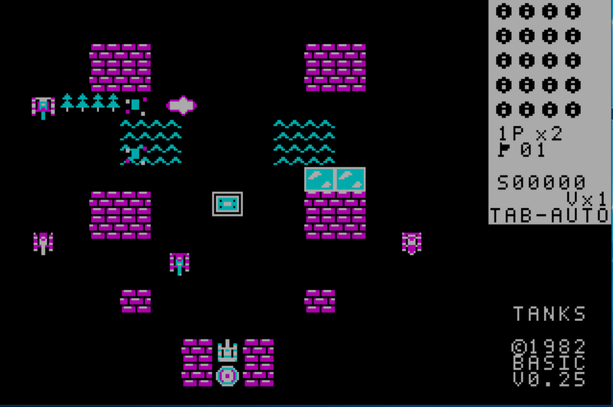

# Танчики / XT Battle City v0.26 — самолёт и точный подбор бонусов

Дата: **13 ноября 2026**. Платформа: **DOS / Intel 8086–8088 / CGA 320×200×4**, одна .COM без файлов настроек.

## Что исправлено

### Самолёт в стиле аркад 1980-х
- Вместо невыразительного пятна самолёт имеет **четыре собственных направленных CGA-силуэта** — вправо, влево, вверх, вниз — с читаемыми крыльями, хвостом, фюзеляжем и кабиной, в духе ранних аркадных шутеров. Это собственная пиксельная графика, а не копия коммерческой игры.
- **Один пролёт за этап**, но **сторона появления, направление, полоса движения и задержка старта выбираются случайно**. Боевой генератор случайных чисел сохраняется: авиация не должна хаотически менять тактику танков.
- Самолёт движется **по 2 пикселя за тик**. Взрывы появляются строго **за самолётом**, на соседних полосах **влево / вправо от его оси** с чередованием через одну клетку вдоль маршрута. Прежние смещённые группы `2–1–2–1` убраны. Падающие бомбы не изображаются — видна только взрывная вспышка.
- **Урон каждой бомбы равен одному обычному выстрелу**. Кирпичи получают повреждения, танки/игроки — обычный урон с учётом брони и защиты, **штаб никогда не повреждается** от бомб. Бонусы от взрывов не исчезают.

### Подбор бонуса строго при касании
- Для обоих игроков, автоматического союзника и врагов теперь применяется **единая проверка пересечения видимых корпусов спрайтов** с прямоугольником бонуса. Подбор за 1,5 клетки до соприкосновения больше не допускается.
- После взятия бонуса **на 14 игровых тиков кратко изменяет CGA-окраску именно получивший его танк**, подтверждая получение.
- Старое мигание контура на *пустой клетке*, создававшее артефакты, удалено. Бонус продолжает оставаться на карте до настоящего подбора либо окончания времени, и его не уничтожают снаряды.

## Сохранены функции предыдущих выпусков

- 35 уровней, по 20 врагов; AUTO с защитой штаба и маршрутами, антипетля и выход из тупиков, лазерные атаки врагов, 14 бонусов, попиксельное движение и повреждение гусениц бронированных танков.
- Кооператив: **1P — стрелки + пробел; 2P — WASD + Ctrl**. Каждый начинает с **трёх жизней** и возрождается у базы, если есть запас. В кооперативе отключён автонапарник, в HUD нет `V×N`; вдвое меньше выпадений бонусов. В одиночном режиме V вызывает AUTO-напарника, Tab переключает AUTO/MAN.
- Полный список кнопок, бонусов, ограничения графики и галерея: [главная страница проекта](../../README.md).

## Приёмка, ограничения

- GitHub Actions: **158 Python-тестов PASS**, 35 карт PASS, аудит 8086 и размер меньше 56 КиБ PASS.
- На SLOW1 в DOSBox-X (8086/CGA) `TANKS.COM /TEST` — **PASS**, включая новые фазы 123–129 и исправленный тест подбора оружия врагом.
- 2048-тактовый `TANKS-TRACE.COM /TRACE` — **PASS: 20/20 врагов, STAGE CLEAR, штаб цел**.
- **Исполняемый файл:** 56 184 байта. **SHA-256:** `CEA54A294CDC10308E930B1B54BD838F8CF8371A07FD560D2BEDF6D899536D79`.
- **Контроль скорости SLOW1 — PASS, с изменчивой загрузкой хоста:** DOSBox-X, Intel 8086/CGA, 384 полностью отрисованных кадра. При **240 cycles/ms** две попеременные ABBA-серии: v0.19 **40,879 / 71,247 / 57,091 / 57,687 с** (среднее **56,726 с**), v0.26 **55,780 / 66,557 / 35,859 / 52,814 с** (среднее **52,753 с**, около **7,0% быстрее** по совокупности). Первая серия отдельно показывала замедление, вторая — ускорение, нагрузка SLOW1 сильно колебалась. При **500 cycles/ms** ABBA: v0.19 **30,146 / 34,413 с** (среднее **32,280 с**), v0.26 **18,961 / 32,413 с** (среднее **25,687 с**, около **20,4% быстрее**). Все 12 запусков — PASS. **Эмуляторные замеры не подтверждают FPS реального 4,77 МГц XT**.
- Физические XT/«Поиск-1» пока не сертифицированы. Нативные графические драйверы EGA/VGA/Hercules/«Поиск-1» не реализованы. Запуск CGA через EGA/VGA — только режим совместимости.

## Загрузка и установка

- [GitHub Release v0.26](https://github.com/BurimBasic/xt-battle-city/releases/tag/v0.26)
- [Скачать архив DOS/CGA](https://github.com/BurimBasic/xt-battle-city/releases/download/v0.26/TANKS-v0.26-DOS-CGA.zip)
- [Скачать TANKS.COM](https://github.com/BurimBasic/xt-battle-city/releases/download/v0.26/TANKS.COM)
- В репозитории: [точный бинарник](../../dist/TANKS.COM), [ZIP](TANKS-v0.26-DOS-CGA.zip). Для DOSBox-X: `mount c <каталог>`, `c:`, `TANKS.COM`.
- **SLOW1 установлено и проверено:** `C:\XT-Battle-City\run\TANKS.COM`, атомарная замена, **56 184 байта**, SHA-256 `CEA54A294CDC10308E930B1B54BD838F8CF8371A07FD560D2BEDF6D899536D79`. **Повторный DOS `/TEST` установленной копии — PASS (37,49 с)**. Откат v0.25: `C:\XT-Battle-City\run\TANKS-v025-backup-20261113-003545.COM`, SHA-256 `75447379AAEEF5FE4BB5C4DC161A2CCBAA98F35278C8A8C23D9D5F61975C8F8F`. Запуск `C:\XT-Battle-City\RUN-CGA.cmd`, открытый ранее DOSBox-X нужно перезапустить.

## Подлинные скриншоты

*Это реальный скриншот предыдущей v0.25, предоставленный пользователем. Он показывает исходный проблемный самолёт и HUD и **не выдаётся** за снимок v0.26.* Другой настоящий архивный CGA-кадр v0.21 сохранён в [галерее](../../docs/screenshots/CGA-DOSBox-X-v0.21-live.png). Для v0.26 актуальный снимок должен быть сделан в работающей игре/эмуляторе; вымышленные изображения не публикуются.
