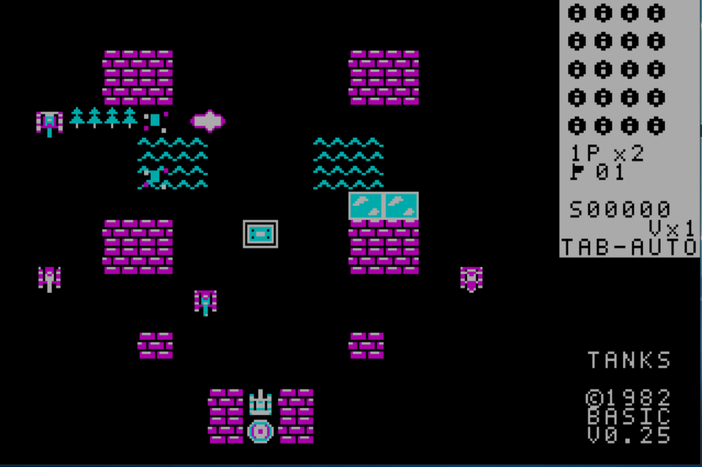
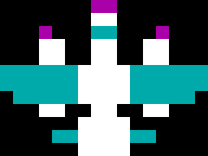

# TANKS / Танчики v0.27 — самолёт 1942, отдача ствола, BURIM

**13 ноября 2026 года**. Совместимый DOS .COM для **8086/8088, CGA 320×200, 4 цвета**. Без 32-битных инструкций, внешних конфигураций и обязательной звуковой карты.

## Самолёт из 1942 — вдвое крупнее танка

- Оригинальный **32×24-пиксельный силуэт двухмоторного самолёта** по мотивам эпохи игрового автомата *1942*: широкие крылья, выраженный фюзеляж, хвост и два двигателя. Четыре направления полёта. Коммерческие спрайты и ROM не копировались.
- **Два винта анимируются** крошечными 1-пиксельными точками с двумя фазами, без полнокадрового пересчёта графики.
- **Уровни 1–5:** один самолёт. **6–14:** два. **15–35:** три пролёта на уровень. Время задержки, маршрут и направление случайны, но выбор полёта не расходует боевой RNG ИИ.
- Самолёт движется на 2 пикселя за игровой тик. Взрывы остаются **строго позади него**, в шахматной последовательности поочерёдно слева/справа от оси. Каждый взрыв наносит урон **как один обычный выстрел**, включая повреждение кирпича и танка. **Штаб от авиационных бомб не разрушается**.

## Новый эффект выстрела

- На самом кончике ствола возникает небольшая округлая вспышка.
- После выстрела ствол мгновенно откатывается назад на **2 пикселя**, возвращаясь по **1 пикселю за такт**, с очисткой старого изображения.
- Эффект работает у **1P и 2P** и не меняет дальность/баллистику.
- Автор на панели — **BURIM** вместо BASIC. Версия — **v0.27**.

## Тактика AUTO

- В одиночной игре AUTO считает **гранату уничтожения всех врагов**, **лазер** и **дополнительную жизнь** приоритетными бонусами. Применяет существующий поиск пути по карте и **не покидает немедленную оборону штаба** ради них.
- Сохранены точное касание бонусов, эффект смены цвета получившего танка, возможности использования усилений врагами, 14 типов бонусов, защита от циклов, тактика последнего противника и кооператив с тремя жизнями каждому игроку.

## Управление и остальные возможности

1P: стрелки, **Пробел** — выстрел. **Tab** — AUTO/ручной. 2P: **WASD + Ctrl**, подключается при первом нажатии, кооператив отключает V-напарника. **V** — вызов автоматического напарника только в одиночном режиме. **P** — пауза, **PageUp/PageDown** на паузе — тестовый выбор уровня, **R** — новая игра, **M** — звук, **C** — палитра CGA, **Esc** — выход. Полный справочник [на главной странице](../../README.md). 35 уровней по 20 врагов, один файл .COM.

## Достоверные проверки

- GitHub Actions: **165 тестов PASS**, **35 карт PASS**, строгая проверка **Intel 8086 ISA PASS**, DOS .COM менее **57 344 байт**.
- На SLOW1: DOSBox-X **8086/CGA**, действительный **`TANKS.COM /TEST` — PASS** (включая новые фазы 130–132: лимит пролётов и откат ствола); **`TANKS-TRACE.COM /TRACE` — PASS: 20/20 врагов уничтожено, STAGE CLEAR, штаб цел**.
- **Размер COM:** **56 726 байт**. **SHA-256:** `970DF8D7B8B23B9212BF7CCB7452FDB3CC1C3727160F0F5EF5F06FA34EE11BA3`.
- В оптимизированном рендерере самолёта 8086 используются четыре 16-битные операции вместо восьми побайтовых на строку и одно прямое восстановление занятых клеток, чтобы не ухудшать скорость XT.
- **Контроль скорости SLOW1 — PASS:** 384 полностью отрисованных кадра, DOSBox-X 8086/CGA, фиксированные **240 cycles/ms**, чередующаяся серия **ABBA**. v0.19: **64,452 и 66,556 с**, среднее **65,504 с**; окончательная оптимизированная v0.27: **36,654 и 62,340 с**, среднее **49,497 с**, то есть **примерно на 24,4% быстрее** по данной серии. Нагрузка SLOW1 колебалась очень сильно: разброс прогонов одной и той же версии не позволяет считать прирост точной оценкой FPS. Исходная неоптимизированная v0.27 в первой серии при 240 cycles/ms отставала от v0.19 (~10,9%), поэтому был оптимизирован масочный блиттер (4 word вместо 8 byte на строку) и обработка грязных клеток. В дополнительном предыдущем контроле при **500 cycles/ms** ещё до оптимизации: v0.19 **22,546 / 25,692 с**, v0.27 **18,862 / 24,190 с**, то есть ~10,7% быстрее. Все прогоны завершились PASS.
- Важное ограничение: **данные эмулятора не подтверждают частоту кадров на физическом XT 4,77 МГц**.

## Скачать

- [GitHub Release v0.27](https://github.com/BurimBasic/xt-battle-city/releases/tag/v0.27)
- [Архив ZIP с TANKS.COM](https://github.com/BurimBasic/xt-battle-city/releases/download/v0.27/TANKS-v0.27-DOS-CGA.zip)
- [Отдельный исполняемый TANKS.COM](https://github.com/BurimBasic/xt-battle-city/releases/download/v0.27/TANKS.COM)

## Скриншоты и видеоадаптеры

*Кадр **старой версии v0.25**, предоставленный игроком. Не изображает новую v0.27.*

*Это **извлечённый из реального исходного кода арт-превью**, а **не скриншот игрового процесса**. Изображение увеличено для просмотра. Никакие несуществующие кадры не публикуются.*

**CGA**: DOSBox-X 8086/CGA протестирован. **EGA/VGA**: возможен только режим совместимости CGA, нативный драйвер ещё не готов. **Hercules и «Поиск-1»**: нативные драйверы/загрузка пока не реализованы. Отдельные скриншоты для неподдерживаемых адаптеров не выдаются за настоящие.

## SLOW1 и откат

Рабочая игра: `C:\XT-Battle-City\run\TANKS.COM`; запуск: `C:\XT-Battle-City\RUN-CGA.cmd`. **Установка SLOW1 выполнена атомарно — PASS.** Рабочий файл `C:\XT-Battle-City\run\TANKS.COM` имеет размер **56 726 байт**, SHA-256 `970DF8D7B8B23B9212BF7CCB7452FDB3CC1C3727160F0F5EF5F06FA34EE11BA3`. Старая v0.26 сохранена как `C:\XT-Battle-City\run\TANKS-v026-backup-20261113-112704.COM`, SHA-256 `CEA54A294CDC10308E930B1B54BD838F8CF8371A07FD560D2BEDF6D899536D79`. **Повторный DOS `/TEST` установленной копии из каталога `run` — PASS (35,18 с)**, установленный SHA-256 совпадает с проверенным кандидатом. Старая версия доступна для атомарного отката.
