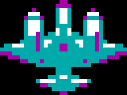

# TANKS / Танчики v0.28 — детализированный двухмоторный самолёт, винты, выстрел и AUTO

**13 ноября 2026.** DOS `.COM` для Intel **8086/8088**, CGA **320×200 / 4 цвета**. Работает без DOS-расширителей и обязательной звуковой карты. 35 уровней, 20 врагов на каждом, 14 бонусов, одиночный AUTO и кооператив 2P сохранены.

## Самолёт образца 1942 года

- **Один авторский мастер-спрайт 32×24 настоящих пикселя**: длинный фюзеляж, кабина, выразительные крылья, два отдельных мотора, хвостовое оперение и раскраска CGA. Вместо растягивания грубой картинки 16×12 используются индивидуальные пиксели; чужой ROM-арт не копируется.
- Четыре ориентации **генерируются из одного исходного спрайта математическим поворотом и отражением**, а не рисуются отдельно. Они заранее упакованы в четыре 384-байтных кадра: никаких поворотов в основном цикле XT.
- **Видимая двухфазная анимация обоих винтов**: маленькие точки-кончики и ступицы закреплены спереди моторов, а координаты учитывают фактическое направление полёта.
- Правила из v0.27 сохраняются: 1 пролёт на уровнях 1–5; 2 на 6–14; 3 на 15–35; полёт 2 пикселя/тик, случайное направление и задержка. Взрывы идут позади самолёта шахматно слева/справа; штаб не разрушают.

## Выстрел танка и AUTO

- Убрана ошибка порядка обновления кадров: первая вспышка **не пропадает** из-за уменьшения фазы до отрисовки. Ствол мгновенно уходит назад на **2 пикселя**, затем возвращается на **1 пиксель в тик**. Двухпиксельная вспышка помещается **перед срезом ствола**, а не внутрь корпуса. Работает у 1P и 2P.
- Наш AUTO проверяет **семь** слотов вражеских выстрелов, включая дополнительные снаряды усиленного оружия.
- На промежуточном чётном такте обрабатываются только **непосредственные угрозы на расстоянии до 24px**; на основном четырёхтактном решении сохраняется 72px контроль и обычная стратегия. Это убирает лишние отступления и сохраняет способность поймать последнего противника. Если выбранное уклонение упирается в препятствие, проверяется противоположный путь.

## Достоверные проверки

- **GitHub Actions:** 170 тестов PASS, 35 карт PASS, строгий аудит набора инструкций 8086 PASS; сборка `make assets && make clean all test`.
- **SLOW1 DOSBox-X, 8086, CGA:** реальный `TANKS.COM /TEST` — **PASS**, включая встроенную проверку направления уклонения.
- **2048 тактов автономной игры:** `TANKS-TRACE.COM /TRACE` — **PASS**; 20 врагов появились, **20/20 уничтожены**, состояние **STAGE CLEAR**.
- **Скорость XT (DOSBox-X 8086/CGA, фиксированные 240 cycles/ms):** серия **ABBA**, 384 полностью отрисованных кадра в каждом запуске. Базовая одобренная v0.19: **40,220 / 40,207 с** (среднее **40,214 с**). v0.28: **36,027 / 36,019 с** (среднее **36,023 с**). По этой серии v0.28 на **10,42% быстрее**; допустимый лимит замедления 5% соблюдён. Эти значения относятся к эмулятору и не подтверждают FPS на физическом PC/XT 4,77 МГц.
- Итоговый `TANKS.COM`: **56 894 байта** (строго меньше 57 344), SHA-256 **`5C061F5D0D4F148C769668A3AEC32F5CF5BC6432B1E3AC275AFE4CB28B1464A3`**. ZIP включает тот же, байт-в-байт идентичный исполняемый файл.

## Скачать и запустить

[ZIP v0.28](https://github.com/BurimBasic/xt-battle-city/releases/download/v0.28/TANKS-v0.28-DOS-CGA.zip) · [Отдельный TANKS.COM](https://github.com/BurimBasic/xt-battle-city/releases/download/v0.28/TANKS.COM) · [Исходный код](../../src/dos/tanks.S).

На SLOW1: `C:\XT-Battle-City\run\TANKS.COM` и `C:\XT-Battle-City\RUN-CGA.cmd`. Управление: Tab — AUTO/MAN, стрелки+Пробел — 1P, WASD+Ctrl — 2P, V — временный союзник (только одиночная игра), P — пауза, C — палитра, M — звук, R — рестарт. Полное описание — [README](../../README.md).

## Подлинность графики

*Это **арт-превью**, автоматически полученное из исходного спрайта v0.28, **не скриншот игрового процесса**.* Предыдущие игровые скриншоты в README подписаны своей реальной версией. CGA подтверждён в DOSBox-X; родные EGA/VGA/Hercules и «Поиск-1» пока не реализованы.
